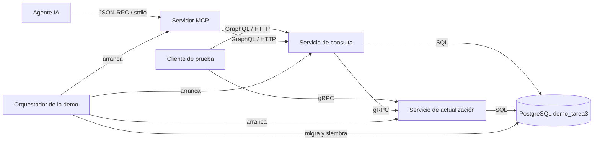
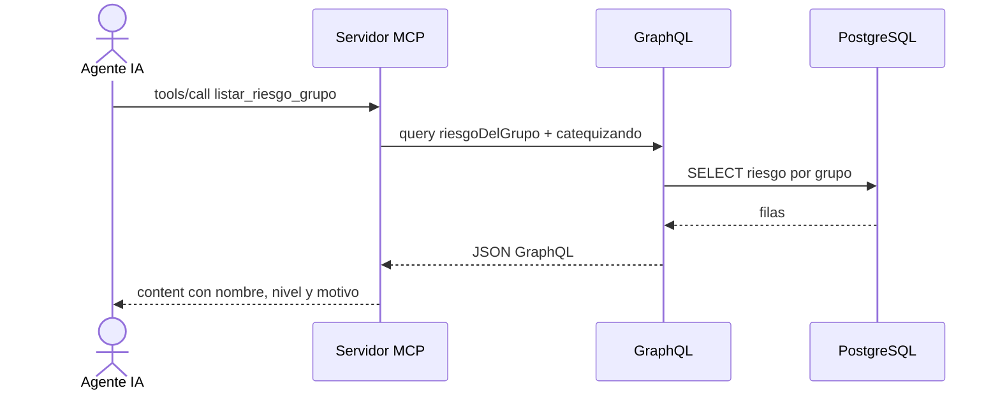
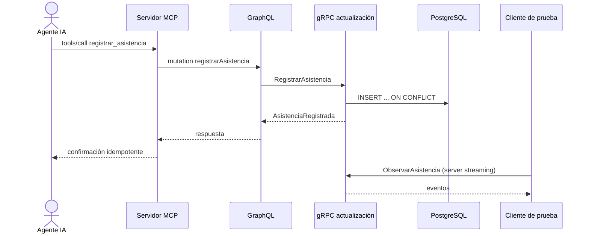

# Tarea 3 — GraphQL, gRPC y MCP en SIGECAT

**Informe integrado del equipo**

**Fecha:** 2026-10-26

**Alcance:** análisis de P1 e implementación integrada de P2, P3, P4 y P5.

## 1. Resumen ejecutivo

La Tarea 3 pide identificar dónde aplican GraphQL y gRPC, validar si aplican y
justificarlo, y decidir cómo los usaría un agente de IA. La conclusión es un
**híbrido por borde**, no un reemplazo de la arquitectura:

- **REST/WatermelonDB** sigue siendo el transporte de la app móvil offline y de
  las escrituras administrativas sensibles. No se cambia.
- **GraphQL** se usa solo en el borde de consulta de paneles con conexión, con
  límite de profundidad y paginación.
- **gRPC** se usa solo servicio a servicio, en la demo local: escritura
  idempotente, lote dominical y streaming. **No es viable en la infraestructura
  aprobada** (Azure Functions + Expo) sin cambiar el plan de hosting.
- **MCP** es una fachada para agentes, no un protocolo de producto. Detrás usa
  GraphQL para leer y gRPC para escribir.

La aceptación del ADR es **para la demo**. Si hubiera que elegir una sola cosa
para producción hoy, la respuesta honesta es **no cambiar nada**: REST y
WatermelonDB siguen siendo la opción ya verificada. GraphQL y gRPC quedan como
demostración y como base de una discusión futura, no como deuda técnica ya
contraída.

## 2. Pregunta y método

Pregunta de análisis: **¿en qué bordes de SIGECAT un protocolo distinto aporta
algo medible sin romper el offline, el costo cero ni la protección de datos?**

Método:

1. Inventario de funcionalidades candidatas desde las specs 001–008 y los
   requerimientos R1–R27 (`inventario-funcionalidades.md`).
2. Matriz de aplicabilidad con veredicto separado para GraphQL y gRPC, contexto
   (offline, panel online, servicio a servicio) y justificación por RF/R
   (`matriz-aplicabilidad.md`).
3. Síntesis «Dónde sí y dónde no» para consultas y actualizaciones.
4. ADR 016 con opciones, decisión, consecuencias y límites
   (`docs/adr/20261019-graphql-grpc-mcp.md`).
5. Decisión para agentes y medición reproducible de la misma pregunta por tres
   caminos (`decision-agente-mcp.md`, `medicion/`).

## 3. Dónde sí y dónde no

| Borde | Protocolo | Sí | No |
| --- | --- | --- | --- |
| App móvil offline | REST/WatermelonDB | Asistencia, avance, justificaciones y sincronización diferida | GraphQL o gRPC en el celular: rompen offline y añaden módulos nativos |
| Paneles con conexión | GraphQL | Ficha, bandeja de justificaciones, avance, riesgo, aptitud, historial, reporte de misa | Mutaciones de negocio duplicadas: delegan por gRPC |
| Servicio a servicio | gRPC | Escritura idempotente, lote dominical, `RecalcularRiesgo`, `ObservarAsistencia` | Borde móvil, navegador familiar y Azure Functions sin contenedor |
| Agente de IA | MCP | Descubrimiento de herramientas, alcance acotado, lectura y escritura idempotente | Reemplazar la API de producto o exponer datos protegidos |
| Administración sensible | REST/HTTP+JSON | Inscripción, enlaces, delegaciones, justificación, aptitud, constancia, auditoría | GraphQL como puerta directa sin las mismas garantías |

La matriz completa tiene 22 filas (F-01 a F-22) y cubre R1–R27. Los «no
aplicable» están escritos: sincronización WatermelonDB, enlaces de familia,
carga de evidencias, retención y administración de identidad no se fuerzan a
GraphQL ni a gRPC.

## 4. Arquitectura esperada de la demo

Esta arquitectura fue comprobada en la integración final: el recorrido real
GraphQL → gRPC → GraphQL → lote → streaming pasó y Claude Code usó la fachada
MCP para consultar y escribir. Los contratos congelados de `tarea3/contratos/`
siguen siendo la fuente de verdad.



El DSL editable está en `docs/diagrams/tarea3-demo-c4.dsl`. No se validó con el
CLI de Structurizr en esta rama; la sintaxis se revisó contra
`docs/diagrams/arquitectura-c4.dsl`. La secuencia de respuestas se muestra aquí
en Mermaid para no duplicar relaciones en el modelo.

### 4.1 Consulta de riesgo por MCP



### 4.2 Escritura y streaming



### 4.3 Contratos y datos

- GraphQL: `tarea3/contratos/schema.graphql`; lectura de grupo, ficha, riesgo y
  reporte; mutaciones que delegan en gRPC (RF-904).
- gRPC: `tarea3/contratos/sigecat.proto`; `RegistrarAsistencia`,
  `RegistrarAsistenciaLote` (client streaming), `RegistrarJustificacion`,
  `RecalcularRiesgo` y `ObservarAsistencia` (server streaming).
- MCP: `tarea3/contratos/herramientas-mcp.md`; seis herramientas, un recurso de
  riesgo y un prompt de revisión dominical.
- Datos: esquema `demo_tarea3` con `grupo`, `catequizando`, `asistencia`,
  `justificacion` y `riesgo`. Sin salud, neurodivergencia ni documentos.
- Puertos: PostgreSQL `55432` (o `PUERTO_POSTGRES`), consulta `4000`,
  actualización `50051`.
- Auth de demo: JWT HS256 con `DEMO_JWT_CLAVE`; GraphQL lo recibe como
  `Authorization: Bearer`, gRPC como metadata `authorization`, MCP como
  `SIGECAT_TOKEN`. El PIN nunca se envía al servidor.

## 5. Decisión para un agente de IA

La comparación completa está en `decision-agente-mcp.md`. La medición se genera
con:

```bash
node docs/tarea-3/medicion/medir-respuestas.mjs
```

Pregunta: «¿quién está en riesgo en el grupo?», con 12 catequizandos ficticios y
4 en riesgo. Los tokens son una aproximación de `bytes / 4`; no es una medición
e2e.

| Camino | Llamadas | Bytes de respuesta | Tokens aprox. | Lectura |
| --- | ---: | ---: | ---: | --- |
| GraphQL: una consulta con riesgo anidado | 1 | 1.976 | 494 | Trae los 12 y el agente filtra |
| GraphQL: riesgo + nombres en 2 llamadas | 2 | 717 | 180 | Eficiente, pero el agente compone la segunda consulta |
| GraphQL: 1 riesgo + 4 nombres | 5 | 791 | 198 | Ronda por nombre; más latencia y error |
| gRPC con el contrato congelado | 12 | 1.336 | 334 | No hay RPC de lectura por grupo; habría que escribir 12 veces |
| MCP: `listar_riesgo_grupo` | 1 | 568 | 142 | El servidor compone; el agente ve solo lo necesario |

**Conclusión:** para un agente conversacional se elige **MCP** porque descubre
herramientas, valida la entrada y acota el alcance en el formato que el modelo
consume. No es más rápido que GraphQL en todos los casos: su mejor argumento es
la composición y la seguridad, no el rendimiento bruto. gRPC directo no sirve
para esta pregunta porque el contrato no tiene lectura de riesgo por grupo.

La tabla anterior se conserva como comparación reproducible de contratos. La
medición integrada de P4, sobre la misma operación con resultado vacío, obtuvo
2 bytes para el contenido MCP (`[]`) y 30 bytes para la respuesta GraphQL cruda
(`{"data":{"riesgoDelGrupo":[]}}`); la petición GraphQL midió 267 bytes. La
transcripción y el método están en `tarea3/evidencia/agente-transcripcion.md` y
`tarea3/evidencia/medicion-agente.md`.

## 6. Trabajo del equipo y commits

| Persona | Rol | Evidencia integrada |
| --- | --- | --- |
| P1 | Análisis, ADR, decisión MCP, informe | `8f8e625`, `c04171e`, `4ebab0d`, `20ef723`, `7c04411`, `e7d55ee` y los commits del informe, el guion y la verificación final (T009-17, T009-18 y cierre) |
| P2 | Servicio de consulta GraphQL | T009-21 a T009-28; 61 pruebas, incluidas 11 contra PostgreSQL real |
| P3 | Servicio de actualización gRPC | T009-31 a T009-37; escrituras, lote, riesgo y streaming reales |
| P4 | Servidor MCP y agente | T009-41 a T009-47; 14 pruebas y transcripción real con Claude Code |
| P5 | Base, siembra, auth, demo y e2e | T009-51 a T009-60; demo en un comando y recorrido integrado sin omisiones |

### 6.1 Hallazgos de la revisión de P5

- La migración usa tablas singulares snake_case y no incluye salud,
  neurodivergencia ni documentos: correcto.
- `CHECK (edad BETWEEN 6 AND 15)` contradice R1 (8–13 años). Es un hallazgo
  menor de la siembra, no del contrato; P5 debe corregirlo o justificarlo.
- Las pruebas E2E respetan `PUERTO_POSTGRES` y usan `55432` solo como valor
  predeterminado.
- Las dependencias de `tarea3/package.json` coinciden con el plan §3; no se
  añadieron paquetes fuera de la lista.

## 7. Verificación

| Comprobación | Estado |
| --- | --- |
| `npm run typecheck` | PASÓ en la verificación final (raíz y API) |
| `npm run lint` | PASÓ en la verificación final |
| `node docs/tarea-3/medicion/medir-respuestas.mjs` | PASÓ; salida reproducible en `medicion/salida-medicion.md` |
| `node --test docs/tarea-3/pruebas/documentacion.test.mjs` | PASÓ: 4/4 (RF-901, RF-911, RF-912, RF-913) |
| `npm test` | PASÓ: cliente 55/55 y API 178/178, incluida integración PostgreSQL/Azurite |
| `npm --prefix tarea3 test` | PASÓ en la integración final con servicios reales y sin recorridos omitidos |
| `npm --prefix tarea3 run demo` | PASÓ: imprimió consulta → mutación → consulta → lote → streaming |
| Cobertura RF de la demo | PASÓ: 28 archivos; RF-901 a RF-913 citados en tests |
| Agente MCP | PASÓ: Claude Code consultó, escribió, recalculó y verificó mediante MCP |

## 8. Riesgos y pendientes

1. **Edad de la siembra**: corregir el `CHECK` 6–15 a 8–13 o documentar por qué
   la demo usa otro rango.
2. **Diagrama**: validar `docs/diagrams/tarea3-demo-c4.dsl` con el CLI de
   Structurizr cuando esté disponible.
3. **Privacidad**: ninguna herramienta MCP debe devolver salud,
   neurodivergencia o documentos; los autores se muestran con
   `identidadOperativa`.
4. **Producción**: gRPC y MCP siguen siendo una demo local; desplegarlos exige
   una decisión de infraestructura nueva y no cambia el REST/WatermelonDB móvil.

## 9. Referencias

- `specs/009-graphql-grpc-mcp/spec.md`, `plan.md`, `tasks.md`
- `docs/tarea-3/inventario-funcionalidades.md`
- `docs/tarea-3/matriz-aplicabilidad.md`
- `docs/adr/20261019-graphql-grpc-mcp.md`
- `docs/tarea-3/decision-agente-mcp.md`
- `docs/tarea-3/medicion/medir-respuestas.mjs`
- `docs/tarea-3/pedidos/p1-para-p4.md`, `p1-para-p5.md`
- `docs/diagrams/tarea3-demo-c4.dsl`
- `tarea3/contratos/schema.graphql`, `sigecat.proto`, `herramientas-mcp.md`
- `docs/adr/20261011-transporte-nativo-watermelondb.md`
- `docs/adr/20261011-configuracion-servidores-azure-flex.md`
- `docs/adr/20260914-zero-trust-para-proteccion-de-datos-de-menores.md`
